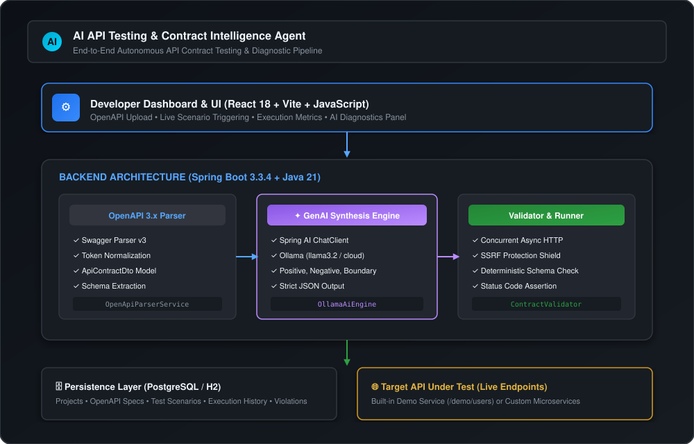
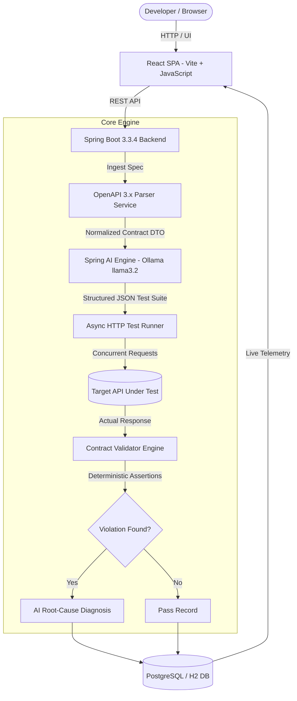

# AI API Testing & Contract Intelligence Agent

[](.github/workflows/ci.yml)
[](https://openjdk.org/projects/jdk/21/)
[](https://spring.io/projects/spring-boot)
[](https://spring.io/projects/spring-ai)
[](https://react.dev/)
[](https://developer.mozilla.org/en-US/docs/Web/JavaScript)
[](https://vitejs.dev/)
[](https://www.docker.com/)

An autonomous AI API testing platform that parses OpenAPI specifications, uses GenAI (Spring AI + Ollama / LLM) to synthesize structured test suites across positive, negative, and boundary scenarios, executes tests against real endpoints, performs deterministic contract validation, and provides automated failure root-cause analysis.

---

## Architecture Diagram





---

## CI/CD Pipeline & Build Status

The repository includes automated continuous integration configured via GitHub Actions.

- **Workflow File**: [`.github/workflows/ci.yml`](.github/workflows/ci.yml)
- **Status Link**: View the live status by navigating to the **Actions** tab of your repository: `https://github.com/<YOUR_USERNAME>/<YOUR_REPO>/actions/workflows/ci.yml`

### Pipeline Jobs Breakdown

| Job | Environment | Execution Steps |
|---|---|---|
| **Backend Build & Test** | `ubuntu-latest` | 1. Checks out repository source code<br>2. Sets up Eclipse Temurin JDK 21<br>3. Restores and caches Maven dependencies<br>4. Runs `mvn clean test -B` using in-memory H2 profile |
| **Frontend Build** | `ubuntu-latest` | 1. Checks out repository source code<br>2. Sets up Node.js 20 environment<br>3. Restores and caches npm packages<br>4. Executes `npm install` and `npm run build` (Vite production bundle) |

---

## Core Capabilities

1. **Autonomous OpenAPI Contract Ingestion**:
   - Parses raw OpenAPI 3.0 and 3.1 specifications in JSON or YAML.
   - Normalizes complex nested schemas into compact `ApiContractDto` models to reduce LLM prompt token consumption.

2. **Multi-Category Test Case Synthesis**:
   - Prompts local LLMs (Ollama `llama3.2`) or cloud providers via Spring AI's `ChatClient` abstraction.
   - Automatically generates structured JSON test suites covering:
     - **Positive Scenarios**: Happy-path requests verifying status codes and required payload responses.
     - **Negative Scenarios**: Unauthorized, malformed, or missing field tests asserting expected 4xx errors.
     - **Boundary & Edge Scenarios**: Min/max integer extremes, boundary strings, empty arrays, and special characters.

3. **Deterministic Contract Validation**:
   - Compares actual live HTTP responses against OpenAPI specifications strictly through deterministic code:
     - Exact HTTP status code validation.
     - JSON Schema type conformity and structure validation.
     - Required field presence assertion.
     - Response header and `Content-Type` matching.

4. **High-Performance Async Test Execution**:
   - Dispatches concurrent HTTP test calls via configurable thread pools.
   - Built-in request timeout limits and response body truncation to protect against memory exhaustion.

5. **SSRF & Outbound Security Guard**:
   - `SsrfProtectionService` intercepts and validates all outbound target URLs.
   - Blocks cloud instance metadata services (`169.254.169.254`), loopback probing in restricted modes, and enforces domain allowlists.

6. **AI Failure Diagnostics & Root-Cause Triage**:
   - When a test fails or a contract violation is detected, the raw failure context is dispatched to the AI diagnostic engine.
   - Produces a clear natural-language explanation, likely root-cause hypothesis, severity rating, and suggested code fix.

7. **Interactive Built-In Defect Demo**:
   - Built-in `/demo/users` endpoints pre-seeded with real contract defects:
     - Status code defect: `POST /demo/users` returns HTTP 200 instead of 201.
     - Missing schema field: `PUT /demo/users/{id}` omits `updatedAt`.

---

## Real-World Use Cases

- **CI/CD Breaking Change Gatekeeper**:
  Run this agent in your staging or release pipeline to verify that recently merged code has not introduced unexpected schema drift, omitted fields, or undocumented status codes.

- **Zero-Effort Test Suite Generation**:
  Teams inheriting legacy or rapidly evolving microservices can upload their OpenAPI specification and instantly produce comprehensive positive and negative test coverage without manual test scripting.

- **Defensive Boundary & Robustness Fuzzing**:
  Discover unhandled edge cases by letting the LLM construct unusual payloads, out-of-range parameters, and malformed inputs that human testers often overlook.

- **Automated Root-Cause Triage for QA Engineers**:
  Rather than parsing raw stack traces and JSON diffs, QA engineers receive plain-text explanations identifying whether a defect originated from an endpoint bug or an outdated API specification.

---

## Project Structure

```
├── .github/
│   ├── workflows/ci.yml              # CI pipeline workflow for Backend & Frontend
│   ├── ISSUE_TEMPLATE/               # Bug report & feature request issue templates
│   └── pull_request_template.md      # Pull request checklist template
├── backend/                          # Spring Boot 3.3.4 (Java 21) REST Service
│   ├── src/main/java/com/apitest/agent/
│   │   ├── ai/                       # Spring AI & Ollama abstractions
│   │   ├── config/                   # Async, CORS, SSRF & Jackson configurations
│   │   ├── controller/               # Project, TestRun, and Demo REST endpoints
│   │   ├── dto/                      # Data Transfer Objects & API models
│   │   ├── exception/                # Global exception handling & custom errors
│   │   ├── executor/                 # Concurrent HTTP test execution engine
│   │   ├── model/                    # JPA persistence entities
│   │   ├── parser/                   # OpenAPI specification normalization service
│   │   ├── repository/               # Spring Data JPA repositories
│   │   ├── service/                  # Business orchestration services
│   │   ├── util/                     # JSON & HTTP helper utilities
│   │   └── validator/                # Deterministic schema & contract validator
│   ├── src/main/resources/           # Application profiles (application.yml, local, test)
│   ├── src/test/                     # Mock AI & integration test suites
│   ├── Dockerfile                    # Multi-stage production container build
│   ├── mvnw / mvnw.cmd               # Maven wrappers for Linux/macOS and Windows
│   └── pom.xml                       # Maven build file
├── docs/
│   └── images/                       # Architecture diagrams & SVG assets
├── frontend/                         # React 18 + JavaScript + Vite SPA
│   ├── src/
│   │   ├── api/                      # Axios HTTP client & API endpoints
│   │   ├── components/               # Status badges, AI badges, viewers, layout
│   │   ├── pages/                    # Dashboard, project detail, test run detail
│   │   ├── App.jsx                   # React application router
│   │   ├── main.jsx                  # React DOM entry point
│   │   └── index.css                 # Global modern dark-theme styles
│   ├── Dockerfile                    # Production Nginx container build
│   ├── vite.config.js                # Vite build & proxy settings
│   └── package.json                  # Frontend dependencies & build scripts
├── sample-data/                      # Example OpenAPI specifications for testing
├── docker-compose.yml                # Orchestration for PostgreSQL, Backend & Frontend
├── .env.example                      # Reference environment configuration
├── .gitignore                        # Comprehensive Git ignore rules
├── .gitattributes                    # Line ending and binary file definitions
├── .editorconfig                     # Code formatting standards across IDEs
├── CONTRIBUTING.md                   # Contribution workflow & commit standards
├── SECURITY.md                       # Security policy & reporting instructions
└── README.md                         # Project documentation
```

---

## Quick Start Guide

### Prerequisites
- **JDK 21** or later
- **Node.js 20+** & **npm**
- **Ollama** (with `llama3.2` model pulled) or access to a cloud LLM
- **Docker & Docker Compose** (optional)

---

### Option A: Running with Docker Compose (Recommended)

1. Make sure Ollama is running on your host machine:
   ```bash
   ollama serve
   ollama pull llama3.2
   ```

2. Copy environment settings:
   ```bash
   cp .env.example .env
   ```

3. Launch all services:
   ```bash
   docker compose up --build
   ```

4. Open the application:
   - **Frontend UI**: [http://localhost:3000](http://localhost:3000)
   - **Backend API**: [http://localhost:8080](http://localhost:8080)
   - **Swagger UI**: [http://localhost:8080/swagger-ui.html](http://localhost:8080/swagger-ui.html)

---

### Option B: Running Locally from Source

#### 1. Start Ollama
```bash
ollama serve
ollama pull llama3.2
```

#### 2. Configure Environment
```bash
cp .env.example .env
```

#### 3. Start Database
Run a local PostgreSQL database on port 5432, or boot only the database via Docker:
```bash
docker compose up postgres -d
```

#### 4. Run Backend
```bash
cd backend
mvn spring-boot:run
```

#### 5. Run Frontend
```bash
cd frontend
npm install
npm run dev
```
*Frontend will be running at [http://localhost:5173](http://localhost:5173).*

---

## Running the Demo Suite

1. Open the dashboard at `http://localhost:5173` (or `http://localhost:3000` under Docker).
2. Click **New Project**:
   - **Name**: `Demo User Service`
   - **Target API Base URL**: `http://localhost:8080`
3. In the **OpenAPI Specification** tab, upload `sample-data/sample-openapi.yaml`.
4. Click **Generate AI Tests** to synthesize test scenarios.
5. Click **Execute Tests**:
   - The test runner executes HTTP requests against the live demo endpoints.
   - The deterministic validator detects status code mismatches and omitted schema fields.
   - The AI diagnostics panel displays root-cause explanations and remediation steps.

---

## Running Automated Tests

### Backend Unit & Integration Tests
```bash
cd backend
mvn clean test
```

### Frontend Production Build
```bash
cd frontend
npm run build
```

---

## Configuration Reference

| Environment Variable | Default Value | Description |
|---|---|---|
| `DATABASE_URL` | `jdbc:postgresql://localhost:5432/api_testing` | JDBC database connection string |
| `DATABASE_USERNAME` | `apitest` | Database user |
| `DATABASE_PASSWORD` | `apitest` | Database password |
| `OLLAMA_BASE_URL` | `http://localhost:11434` | Ollama service endpoint |
| `OLLAMA_MODEL` | `llama3.2` | Local LLM model identifier |
| `APP_TESTING_DEMO_MODE` | `false` | Enables strict target host restrictions |
| `APP_TESTING_ALLOWED_HOSTS` | ` ` | Comma-separated allowed hostnames |
| `APP_DEMO_DEFECTS_ENABLED` | `true` | Enables intentional defects in demo API |
| `CORS_ALLOWED_ORIGINS` | `http://localhost:5173,http://localhost:3000` | Allowed CORS origins |


## License

This repository is distributed under the [MIT License](LICENSE).
